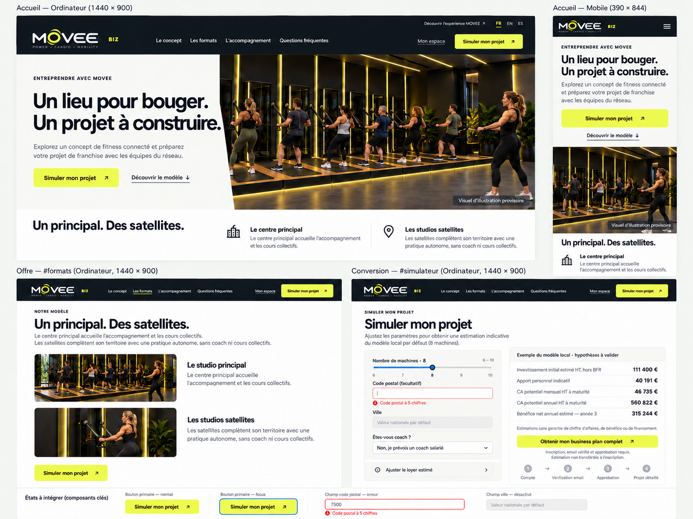
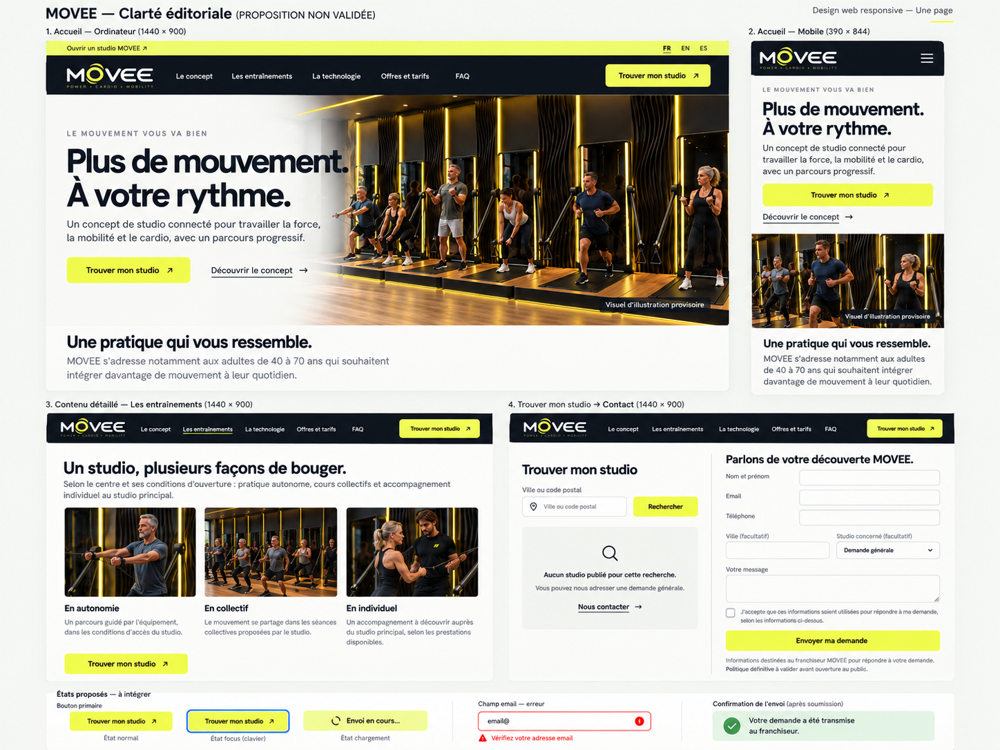
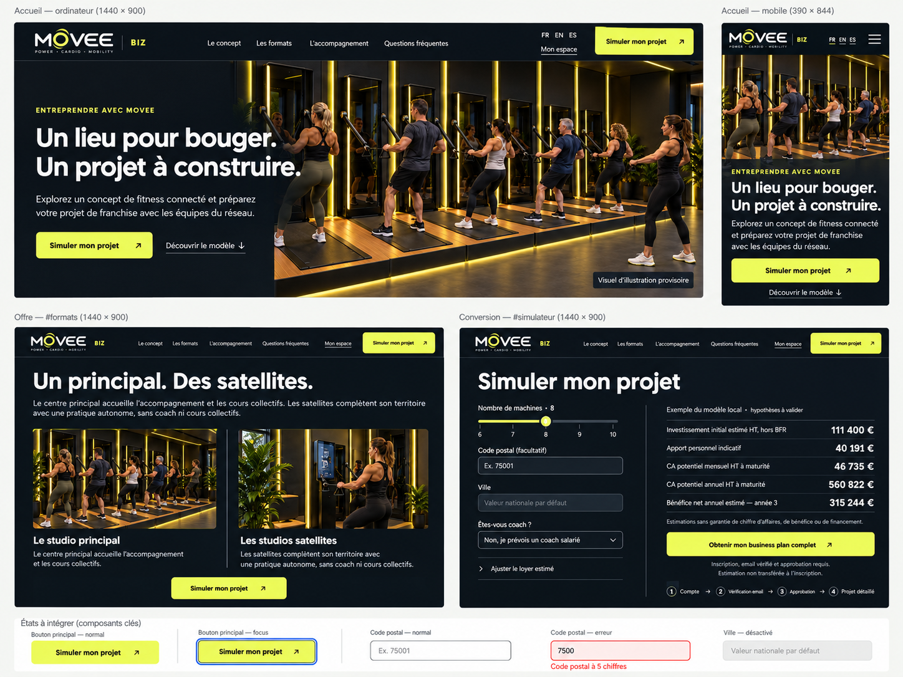
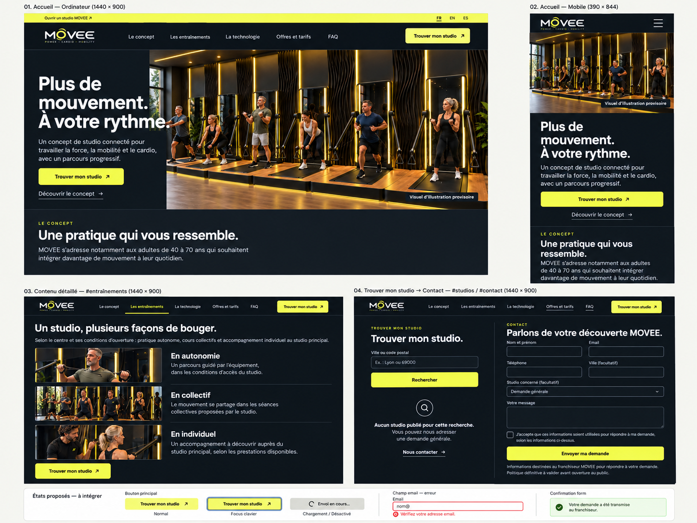

# MOVEE Biz et Info — étude Product Design

31 octobre 2026. **Propositions à choisir ; aucune intégration ni publication.**

Référence canonique : [DESIGN_SYSTEM_MOVEE.md v1.2](../DESIGN_SYSTEM_MOVEE.md).
Cette étude ne modifie aucun invariant de cette charte et ne constitue pas une
nouvelle charte. Les décisions Mobile Light et Black sont validées ; le choix de
leur déclinaison et de la mise en page des sites ne l'est pas. Aucun sélecteur de
thème Web n'est ajouté implicitement.

## Ce qui a été examiné

- Les référentiels fonctionnel et technique de MOVEE Biz dans
  `../../movee-biz/codex/`, ainsi que leurs instructions AGENTS.
- La charte commune v1.2 et les deux planches Mobile validées, réellement ouvertes :
  `../../output/design/movee-mobile-2026-10-31/clarte-active.png` et `impulsion.png`.
- Les routes et services publics de Biz, `public_layout.py`, les templates
  `public.html`, `public_sections.html`, `public_simulator.html`, `auth.html`,
  le catalogue de contenus et les styles public/administration.
- Les deux sites locaux servis depuis l'application existante et sa base dédiée,
  en lecture seule, via le navigateur intégré. Accueils, navigation d'ancrage,
  recherche de studio vide et résultats du simulateur observés. Captures dans
  [references/](references/). Aucun formulaire envoyé ni compte connecté.
- Les images locales des pods et le logo d'origine. Les maquettes sont générées
  avec l'outil ImageGen intégré, suivant Product Design get-context puis ideate.
  Les prompts exacts sont conservés dans [PROMPTS.md](PROMPTS.md).

Les anciens paragraphes des référentiels ou guides qui décrivent encore des pages
séparées ou des fonctionnalités « en développement » ne sont pas une preuve du
comportement courant : le routage et les écrans observés priment pour décrire
l'implémentation. Le JSON de contenus est une source de seed ; le site lit les
contenus publiés en BDD. Aucune réinitialisation éditoriale effectuée.

## Public, offre et conversion vérifiés

**Info** est le site de découverte des studios et de la pratique MOVEE, destiné
notamment aux adultes de 40 à 70 ans. Ce n'est pas un blog. Il explique force,
mobilité et cardio, les pods, l'autonomie, le collectif et l'individuel, puis
permet de rechercher les centres publiés ou d'adresser une demande au réseau.
Les modalités et tarifs sont à confirmer auprès du centre/réseau : aucun prix,
essai gratuit, bénéfice médical ou réservation publique ne doit être inventé.

**Biz** s'adresse aux porteurs de projet de franchise. L'offre vérifiée distingue
le centre principal, avec accompagnement et collectif, des satellites autonomes
rattachés, sans coach ni collectif. Le parcours public aboutit à une estimation
de centre principal de 6 à 10 machines, puis à l'espace projet professionnel.
L'inscription, la vérification email et l'approbation manuelle restent nécessaires.
La simulation publique n'est ni sauvegardée ni transférée lors de l'inscription.
Le contact public du réseau se trouve actuellement dans Info ; aucun formulaire
Biz indépendant n'est supposé. L'espace candidat dispose ensuite de ses échanges
avec le réseau, sans introduire de nouvelle messagerie publique.

**Preuves disponibles :** description du matériel et du fonctionnement, parcours
effectivement implémenté, hypothèses du modèle consultables dans les outils
autorisés. **Non disponibles comme preuves commerciales :** témoignages clients,
performances d'un studio exploité, certifications ou résultats santé, liste de
studios publiée dans l'état local observé. Les photos générées et les vidéos
génériques restent signalées ; aucune n'atteste un studio réel.

## Architecture conservée et vues représentatives

Les deux sites restent des one-pagers : menu et CTA internes pointent sur des
ancres, FAQ dernier bloc avant le pied de page. Les « pages » de détail demandées
sont présentées comme des vues rapprochées de ces sections existantes. Aucun
nouveau routage éditorial proposé. La sortie Biz vers le simulateur complet et
les écrans nécessaires d'authentification est conservée.

| Site | Vue accueil | Vue de contenu/offre | Vue de conversion |
| --- | --- | --- | --- |
| Biz | `/fr/` ordinateur et mobile | `#formats` — principal / satellites | `#simulateur`, puis `/auth/projects?lang=fr` et ses gardes d'accès |
| Info | `/fr/` ordinateur et mobile | `#entrainements` — autonomie / collectif / individuel | `#studios`, puis `#contact` et formulaire existant |

Ordre de travail proposé, encore à valider :

- Biz : accueil → concept → formats → accompagnement / parcours → simulateur →
  FAQ → pied de page. La présentation en images reste dans le récit du concept.
- Info : accueil → concept → entraînements → technologie → parcours découverte →
  offres → trouver mon studio → contact → FAQ → pied de page. La présentation en
  images est intégrée au récit, sans vidéo automatique.

Les liens croisés existants restent secondaires : « Ouvrir un studio MOVEE »
vers Biz, « Découvrir l'expérience MOVEE » vers Info, en conservant la langue.
Ne pas inventer de lien App Store ou de connexion Mobile interdomaines : aucune
destination publique validée n'a été vérifiée pour ce parcours. FR/EN/ES restent
les langues du site ; ne pas ajouter l'allemand par simple copie de Mobile.

## Deux variantes au sein de l'identité validée

Chaque planche compare les mêmes quatre vues : accueil ordinateur, accueil
mobile, contenu détaillé ordinateur, conversion ordinateur. Les cadres sont des
intentions 1440 × 900 et 390 × 844, réduites dans la planche ; ce ne sont pas des
captures d'un frontend exécuté à ces dimensions. Les détails responsive de toutes
les sections seront testés lors de l'intégration après choix.

### Clarté éditoriale

Fond de lecture Light, en-tête noir avec logo original, titres Manrope, corps
système, action jaune/encre. Accueil composé en texte et photographie séparés ;
sur mobile, message et action avant l'image. Le modèle économique se lit comme
une explication, puis comme un formulaire : pas comme un tableau de promesses.
La composition emploie davantage de blanc et des séparations simples.

### Immersion structurée

Fond Black et surfaces de la charte, titres Sora, même jaune, même logo et mêmes
principes de contrôle. La photographie occupe davantage l'accueil ; sur mobile,
elle précède le message. Les formats Biz s'exposent côte à côte, tandis que les
pratiques Info se développent en lignes image/texte. Les formulaires gardent une
surface calme, sans effets néon dans les composants. Les LED des photos restent
un élément d'illustration du studio, pas un langage de décoration de l'interface.

**Recommandation : Clarté éditoriale pour les deux sites.** Les longs textes,
conditions d'accès et formulaires y sont plus faciles à parcourir, tout en
gardant le caractère MOVEE par le logo, le jaune et les photographies. Immersion
structurée est une alternative cohérente si la présence visuelle du studio est
prioritaire. Cette préférence de conception n'est pas une mesure utilisateur et
ne présume pas d'un gain de conversion. Les deux sites peuvent être choisis
séparément sans modifier les règles communes.

## Contenus et CTA : modifications proposées, jamais appliquées

| Élément actuel | Proposition | Motif |
| --- | --- | --- |
| Hero Biz « Obtenir mon business plan complet » pointant sur `#simulateur` | « Simuler mon projet » | Nommer l'action publique qui se produit réellement |
| CTA du simulateur Biz | Conserver le libellé existant, avec accès conditionné visible | Aucun téléchargement immédiat ni transfert de calcul implicite |
| Secondaire Info « Parlons de votre projet » vers contact | « Découvrir le concept » dans le hero ; contact explicite plus bas | Distinguer découverte d'une pratique et projet de franchise |
| Liens « Découvrir les formats/entraînements » revenant à leur propre section | Supprimer les liens circulaires ; un CTA utile vers simulation/studios | Éviter une fausse progression |
| Aucun résultat de recherche Info | Conserver l'état vide et proposer le lien d'ancrage « Nous contacter » | Suite utile sans inventer de centre |
| FAQ Biz disant encore que moteur/exports sont en développement | Réécrire après relecture éditoriale | Le code et les parcours actuels montrent ces fonctions ; l'accès reste conditionné |

Les contenus restent des propositions éditoriales, comme le signale l'aperçu
local. Les trois langues et les réserves métier devront être relues ensemble.
Le texte de confidentialité complet existant ne sera pas remplacé par le résumé
de la planche ; sa validation juridique n'est pas obtenue par ce travail graphique.

## Simulateur : contexte exact des valeurs montrées

La vue observée est le défaut **8 machines**, ville non renseignée, coach salarié,
référentiel local courant. Valeurs affichées : investissement HT hors BFR
111 400 €, apport indicatif 40 191 €, CA mensuel HT à maturité 46 735 €, CA annuel
HT à maturité 560 822 €, bénéfice net de l'année 3 315 244 €.
Ce sont des sorties du modèle local, pas des chiffres qualifiés comme réalistes
par l'étude design. Aucun calcul ou paramètre n'a été modifié. Ne pas les afficher
comme statistiques de réseau, promesse de rendement ou preuve de financement.

Conserver les cinq métriques sans masquer une perte éventuelle, la monnaie après
le montant, les euros entiers et les réserves complètes. L'apport utilise
l'hypothèse du modèle incluant sa réserve de démarrage, hors avance de TVA et
frais bancaires ; aucune garantie de prêt. Le bénéfice n'est ni rémunération
personnelle ni trésorerie. Le rôle de coach exploitant et ses conséquences
doivent rester expliqués près du choix concerné. Les textes réduits sur les
planches n'autorisent pas à supprimer ces informations.

## Spécification de présentation à valider pour l'intégration

Aucun nouveau token commun n'est nécessaire. Hériter des couleurs, polices,
rayons et tailles de contrôle v1.2. Échelle marketing proposée uniquement aux
sites : H1 48–56 px ordinateur, 32–36 px mobile, ligne 1,1–1,2 ; corps 16/24 ;
largeur de lecture environ 60–65 caractères ; conteneur desktop maximal 1200 px,
marges 20 px mobile et 32 px minimum desktop. Points de rupture à déterminer
par le contenu, pas par le modèle de téléphone.

- Barre de navigation : ancres, sélection visible autrement que par couleur,
  menu mobile natif utilisable au clavier. Ne pas reprendre la tabbar Mobile.
- Un CTA dominant par groupe, secondaires textuels soulignés ; éviter le bouton
  répété partout sans progression. Zone interactive minimale 48 px, contrôles
  de formulaire 52 px, retour à la ligne autorisé.
- Ancres : décalage tenant compte de l'en-tête, titre de destination non masqué,
  lien d'évitement, ordre de titres cohérent ; focus perceptible et sans piège.
- Mobile : colonnes devenant une seule pile ; résultat du simulateur après les
  paramètres, champs avec labels au-dessus ; consentement et action visibles
  sans défilement horizontal. Aucun CTA fixe qui masque un champ ou le clavier.
- Réutiliser les familles Manrope/Sora et licences existantes ; prévoir les
  ressources locales dans le dossier commun avant intégration, sans dépendance
  à une police téléchargée à chaque visite. Logo original, sans recomposition.
- Vidéos lancées par geste, contrôles/description accessibles ; aucune animation
  sonore automatique. Respecter reduced motion pour tout mouvement de page.

## États et accessibilité à réaliser et vérifier après choix

Les planches montrent quelques états, pas une certification d'accessibilité.
Les comportements ne sont pas testables dans une image générée.

Contrastes calculés sur les valeurs hexadécimales de la charte (luminance sRGB,
ratio WCAG), pas sur les pixels approximés des maquettes :

| Combinaison | Ratio |
| --- | --- |
| Texte encre / bouton jaune | 16,89:1 |
| Texte encre / fond Light | 16,96:1 |
| Texte secondaire Light / fond Light | 5,65:1 |
| Texte principal Black / fond Black | 17,40:1 |
| Texte secondaire Black / surface Black | 8,49:1 |
| Contour contrôle Light / surface blanche | 3,80:1 |
| Contour contrôle Black / surface Black | 4,40:1 |
| Texte danger Light / surface danger Light | 6,29:1 |
| Texte danger Black / surface danger Black | 8,15:1 |

Ces paires satisfont les seuils correspondants de la charte. Cela ne certifie
pas l'interface complète : survol, focus, photographies et états devront être
contrôlés dans le rendu réel après intégration.

| Composant | États / comportement attendus |
| --- | --- |
| Bouton/lien | Normal, survol, actif, focus visible, désactivé avec état sémantique ; aucun changement de taille au survol |
| Champ | Label permanent, requis/facultatif explicite, saisie conservée en erreur, aide associée, erreur en texte et pas seulement en rouge |
| Recherche studio | État vide réellement observé, résultats seulement si publiés, erreur distincte d'une absence de studio |
| Simulation | Chargement, ville en recherche/choix/absence/erreur, défaut national explicite, calcul indisponible distinct de zéro, ville désactivée tant que non disponible |
| Slider 6–10 | Valeur textuelle, limites visibles, flèches du clavier, pas entier, focus visible |
| Contact | Consentement non précoché, validation serveur conservée, erreur champ + synthèse si nécessaire, soumission annoncée, confirmation uniquement après succès réel |
| FAQ/menu | Contrôles natifs, état développé annoncé, activation clavier, ordre de lecture cohérent |

Le statut « Envoi en cours » montré est une proposition de retour d'état, pas une
affirmation que cette présentation existe déjà. Les gardes CSRF, consentement,
confidentialité versionnée, rate-limit et vérification/approbation ne changent pas.
Avant intégration : mesurer les paires réelles texte/fond et contrôle/fond,
vérifier clavier, zoom 200 %, reflow 320 px, mobile avec clavier et longs textes
FR/EN/ES. Les limites de champs doivent rester contrastées ; le token border
séparateur ne remplace pas control.border. Contrôle des chiffres et libellés
avec les vraies réponses du modèle, sans réécriture frontend des règles métier.

## Limites des images générées et corrections impératives

Les maquettes sont des intentions de composition, pas des fichiers à importer
comme pages ni une source normative de textes ou de logo. Le JSON/CMS et la
charte priment sur les approximations ImageGen.

- La première planche Biz Clarté avait ajouté des qualificatifs et des liens
  absents du projet. **La version finale `biz-clarte-editoriale-v2.png` corrige
  ces ajouts**, rétablit les textes existants et conserve le seul lien vers
  `#simulateur`. L'ancienne image sans suffixe est une version de travail écartée,
  pas une option supplémentaire à choisir.
- Quelques captures de maquettes raccourcissent les réserves, la confidentialité
  ou le texte d'aide coach. Intégration : restaurer les textes complets du CMS,
  conserver consentement et absence de transfert, pas de contenu essentiel tronqué.
- Toute transition photographique diffuse générée n'est pas un nouveau token de
  dégradé ; les zones de texte seront des surfaces unies contrastées.
- Les pictogrammes, contours, polices, rayons, espacements et formes exactes du
  logo seront ceux des vrais assets et composants, pas les pixels approximés.
- Les tailles mentionnées sont les cibles des frames ; la résolution du fichier
  généré est celle de la planche exportée, sans prétention au pixel-perfect.

## Suite après choix seulement

Consigner le choix explicite de chaque site dans le dossier commun et y ajouter
les adaptations retenues. Tout changement de règle partagée fera l'objet d'un
arbitrage explicite avant mise à jour de DESIGN_SYSTEM_MOVEE.md. L'administration
Biz utilise encore la palette verte de `auth_static/auth.css` : cette divergence
existante est identifiée, pas corrigée ni approuvée par les présentes planches.
La charte prévoit sa réutilisation future, pas une intégration Admin déjà réalisée.

Intégrer ensuite dans Flask/Jinja, CSS natif et JavaScript existants, sans nouveau
framework, backend ou service. Conserver CMS BDD, langues, routes, droits, modèle
financier et formulaires. Recetter les deux accueils et parcours représentatifs
sur ordinateur/mobile, puis les régressions publiques appropriées. Aucun
déploiement sans instruction ultérieure.

À ce stade : seules captures, prompts, maquettes et étude dans ce dossier commun.
Pas de modification du code, de la charte canonique, des données ou des services
Backend/Mobile/Admin. Le serveur Biz local existant a été démarré pour l'examen,
avec sa propre configuration ; le pilotage commun n'a pas été modifié.
